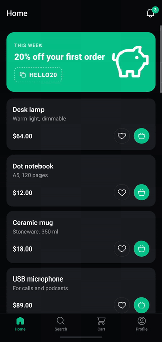

# Lordicon × Expo

Animated [Lordicon](https://lordicon.com/) icons in an Expo app, with
[`@lordicon/react-native`](https://www.npmjs.com/package/@lordicon/react-native): icons in the tab
bar, in buttons, lists and settings, that follow the app's state, on Android, iOS and the web.



```sh
npm install
npm run web        # in the browser, with nothing more to install
npm run android    # on a phone or an emulator, with Android Studio
npm run ios        # on a Mac, with Xcode
```

On a phone the app is a development build (step 2 below); the web runs as it is.

## Lordicon in your Expo app

**1. Install**

```sh
npx expo install @lordicon/react-native
```

**2. Build the app.** The package has native code: it runs in a
[development build](https://docs.expo.dev/develop/development-builds/introduction/), not in Expo
Go. No config plugin is needed:

```sh
npx expo run:android    # or npx expo run:ios, or EAS Build
```

**3. On the web**, copy the engine's files into `public/` after every install, in
`package.json`:

```json
"scripts": { "postinstall": "lordicon-assets public/lordicon" }
```

and say where they are, around the app in `src/app/_layout.tsx`:

```tsx
import { LordIconProvider } from '@lordicon/react-native';

<LordIconProvider assets="/lordicon/">
    <Stack />
</LordIconProvider>;
```

**4. Use it**, in any screen:

```tsx
import { LordIcon } from '@lordicon/react-native';
import bell from '@/assets/icons/bell.json';

<LordIcon icon={bell} trigger="in" size={32} />;
```

Pick icons on [lordicon.com](https://lordicon.com/), give them your style and colours there, and
download them as Lottie JSON into `assets/icons/`, as here.

## What's inside

| Screen  | Shows                                                                                           | Code                                                         |
| ------- | ----------------------------------------------------------------------------------------------- | ------------------------------------------------------------ |
| Tabs    | Icons that morph when their tab is chosen, no ripple over them, a tap you feel                  | [`src/app/(tabs)/_layout.tsx`](<src/app/(tabs)/_layout.tsx>) |
| Home    | An offer with a piggy bank, a heart that follows a like, a basket played from `onPress`, a bell | [`src/app/(tabs)/index.tsx`](<src/app/(tabs)/index.tsx>)     |
| Inbox   | Icons that enter one after another as the screen slides in                                      | [`src/app/inbox.tsx`](src/app/inbox.tsx)                     |
| Cart    | A bin that plays before its line goes, a card then a loop while paying, confetti                | [`src/app/(tabs)/cart.tsx`](<src/app/(tabs)/cart.tsx>)       |
| Search  | A magnifier that follows the field's focus, a cross that comes with the text                    | [`src/app/(tabs)/search.tsx`](<src/app/(tabs)/search.tsx>)   |
| Profile | An avatar that enters on every visit, switches with icons, questions that open                  | [`src/app/(tabs)/profile.tsx`](<src/app/(tabs)/profile.tsx>) |
| Layout  | The engine's files on the web, icons in the theme's colour, light and dark                      | [`src/app/_layout.tsx`](src/app/_layout.tsx)                 |

The offer and the toast are in [`src/components/`](src/components/), the app's state (cart, likes,
notifications) in [`src/store.tsx`](src/store.tsx).

## Good to know

- **State in, animation out.** A like, a count, a switch: give it to the icon as `value` and it
  plays what fits, there and back, or a loop while it is true. For a tap of any button, play the
  icon from its `onPress` with a ref; `await icon.current?.play()` waits for the end, before the
  line it sits in goes.
- **Tab bars.** The template starts with `NativeTabs`, the system's tab bar: it takes only
  symbols and images. Animated icons need `Tabs` from `expo-router`, drawn by React Native. A
  tab's icon follows its tab with `useTabFocus`:

    ```tsx
    function TabIcon({ navigation, ...props }: LordIconProps & { navigation: FocusSource }) {
        return <LordIcon {...props} state="morph-select" value={useTabFocus(navigation)} />;
    }

    <Tabs
        screenOptions={({ route, navigation }) => ({
            tabBarIcon: ({ color, size }) => (
                <TabIcon
                    icon={icons[route.name]}
                    navigation={navigation}
                    color={color}
                    size={size}
                />
            ),
        })}
    />;
    ```

- **The ripple on Android.** A tab's ripple washes over its icon. `tabBarButton` with
  `pressColor="transparent"` leaves the icon to answer the tap; `PlatformPressable` comes from
  `expo-router/react-navigation`.
- **A morph that turns.** A `morph-*` state goes to its second look and back. Most files say
  where it turns (`morph-select:0.5` in their markers); when one does not, as the home icon
  here, `trigger="follow(ratio=0.5)"` says it, and the icon stays on its second look.
- **An entrance on every visit.** Tabs stay mounted, so an `intro` plays once. To play it each
  time a tab shows, give the icon a new `key` then, as `useVisit()` in
  [`src/entrance.ts`](src/entrance.ts) does: the icon mounts anew and enters from nothing.
- **Light and dark.** `LordIconProvider color` draws every icon in the theme's text colour, as a
  tinted image: here from `useColorScheme()`. An icon's own `color` wins.
- **Haptics** go well with an icon that answers a tap: `expo-haptics`, on phones only, in
  [`src/haptics.ts`](src/haptics.ts).
- **Less motion**: when the viewer asks for it (Reduce Motion, Remove animations), icons stay
  still or jump to their look. `motion="always"` opts one out.
- **The web** is rendered ahead (`web.output: static`): icons draw once the page's JavaScript
  runs, at the size they already have.
- **After updating `@lordicon/react-native`**, build the app again (`npx expo run:android`): the
  engine is native code, which a JavaScript reload does not bring in.
- **iOS**: Expo SDK 58 builds with Xcode 26.
- Every prop, trigger and option: the
  [`@lordicon/react-native`](https://www.npmjs.com/package/@lordicon/react-native) README.

## How this app is made

It started as the app `npx create-expo-app` makes (the default template: Expo SDK 58, Expo Router,
TypeScript), with the template's starter screens taken out. What is left is the demo:

- `src/app/`: the screens, one file each, as Expo Router reads them;
- `src/components/`: the offer, the toast, the button and the bell in the header;
- `src/store.tsx`: the products, the cart, the likes and the notifications;
- `assets/icons/`: the icons, as downloaded from lordicon.com.

To check a change, the same as CI does:

```sh
npm run lint           # ESLint, through expo lint
npm run check          # TypeScript
npm run format         # Prettier
npm run build:web      # the web build, into dist/
```

## License

MIT, see [LICENSE.md](LICENSE.md). The icons are Lordicon's, under the
[Lordicon License Terms](https://lordicon.com/licenses).
